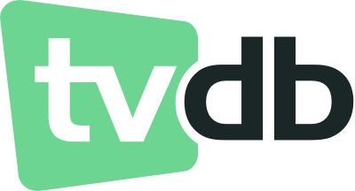

# Genova IPTV – Modern Multiplatform IPTV & M3U Player

> 🎉 **Available now on Google Play (Android Phone, Tablet & Android TV)**
>
> - **[Get Genova IPTV on Google Play](https://play.google.com/store/apps/details?id=com.genova.player)**
> - **[Official Website & Platform Hub](https://mainthreadapps.com/genovaiptv/)**
> - **[Release Notes](https://mainthreadapps.com/genovaiptv/releases/)**

  

---

## 🎬 What is Genova IPTV?

**Genova IPTV** is a fast, privacy-first **"Bring Your Own Source"** IPTV & M3U player. Connect the streaming sources you already own (M3U/M3U8 playlists or compatible services) and browse their catalog in a clean, adaptive interface across your phone, tablet, and TV.

Browsing the interface, managing favorites, and exploring the built-in demo catalog are completely free. Playing streams from your own source starts with a **7-day free trial**.

---

## 📱 Platform Availability & Rollout Order

| Platform | Status | Link / Notes |
| :--- | :--- | :--- |
| **Android (Phone & Tablet)** | 🟢 **Available** | **[Download on Google Play](https://play.google.com/store/apps/details?id=com.genova.player)** (Android 8.0+, Material Design 3) |
| **Android TV & Google TV** | 🟢 **Available** | **[Download on Google Play](https://play.google.com/store/apps/details?id=com.genova.player)** (10-foot remote/D-pad UI, Watch Next) |
| **iPhone (iOS)** | 🟡 **Next Release** | Next platform in line (App Store, high-performance native playback engine) |
| **Apple TV (tvOS)** | 🟣 **Planned** | Following the iOS release (10-foot living-room UI, native playback engine) |
| **iPad (iPadOS)** | 🟣 **Planned** | Adaptive multi-pane layout and Picture-in-Picture |
| **Desktop (macOS first)** | 🟣 **Planned** | macOS first, followed by Windows and Linux |

---

## ✨ Key Features

- **Multi-Source & Offline-First**: Connect remote M3U/M3U8 playlist URLs or compatible streaming APIs (server URL, username, password). Manage multiple providers at once with fast background sync and instant local browsing.
- **Live TV & Electronic Program Guide (EPG)**: Clean EPG timeline showing what is airing now and coming up next, with channel logos, progress bars, and schedule browsing right below the player.
- **Continue Watching & Picture-in-Picture (PiP)**: Resume movies and series right where you left off, multitask with PiP on phones and tablets, select audio/subtitle tracks, and rely on automatic stream fallback.
- **Universal Real-Time Search**: Find any channel, movie, or series in seconds across all active providers, pin favorites to Home, and hide unwanted categories.
- **Adaptive by Design**: One-handed bottom navigation on phones, split-pane views on tablets, and a dedicated 10-foot remote (D-pad) interface on Android TV.
- **Privacy First & 100% Ad-Free**: Playlists, credentials, and watch history stay stored locally on your device. No user account required, zero ads, no data sold.

---

## 🚀 Getting Started

1. **Install Genova IPTV** from [Google Play](https://play.google.com/store/apps/details?id=com.genova.player) and explore the interface immediately with the built-in demo catalog.
2. **Add Your Source**: Open *Settings › Providers* to enter your M3U/M3U8 playlist URL or compatible service credentials.
3. **Start Your 7-Day Free Trial**: Launch playback on your own source to start your 7-day Genova Premium trial.

> ⚠️ **Important — Player Only ("Bring Your Own Source")**: Genova IPTV is a media player only and ships with no preloaded provider, channel, or media catalog (aside from fictional demo data). The app does not provide, host, recommend, or resell any IPTV service or stream.

---

## ❓ FAQ

**Q: Does Genova provide IPTV channels?**
> No. Genova is a player only. You must provide your own legal streaming sources (M3U/M3U8 playlist URL or compatible service credentials).

**Q: How does pricing work?**
> Browsing, favorites, and the built-in demo catalog are free. Playing streams from your own provider requires **Genova Premium**: 7-day free trial, then **€2.99/month** or **€19.99/year** (billed via Google Play in your local currency), covering both your Android mobile devices and Android TV. Early subscribers keep their Tier 1 launch price locked in as long as their subscription remains active.

**Q: Is my data private?**
> Yes. Your playlists, credentials, and settings are stored locally on your device and never sent to us. The app only sends pseudonymous usage statistics and crash reports to help us improve it; see the [Privacy Policy](https://mainthreadapps.com/genovaiptv/privacy-policy/).

---

## 💬 Feedback & Support

- **🌐 Official Website**: [mainthreadapps.com/genovaiptv](https://mainthreadapps.com/genovaiptv/)
- **📋 Release Notes**: [mainthreadapps.com/genovaiptv/releases](https://mainthreadapps.com/genovaiptv/releases/)
- **🐛 Bug Reports**: [GitHub Issues](https://github.com/GenovaIPTV/genova-public/issues)
- **💡 Feature Requests & Q&A**: [GitHub Discussions](https://github.com/GenovaIPTV/genova-public/discussions)
- **⭐ Rate the app**: [Leave a review on Google Play](https://play.google.com/store/apps/details?id=com.genova.player)

---

## 🙏 Credits

Series artwork and episode details come from [TMDB](https://www.themoviedb.org) and [TheTVDB](https://thetvdb.com). Genova is not endorsed or certified by TMDB or TheTVDB.

&nbsp;&nbsp;

---

  © 2026 Main Thread Apps

